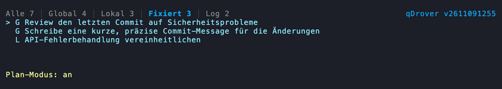

# qDrover

**qDrover** ("query drover") ist ein in Go geschriebenes "prompt-querying"-Tool mit dem sich Prompts erstellen, verwalten und an eine [Herdr](https://herdr.dev)-Pane in welcher Claude-Code ausgeführt wird senden lassen.



## Überblick

qDrover verwaltet Text-Prompts, die im Terminal angelegt, bearbeitet, sortiert und wieder gelöscht werden können. Das Board hat vier Reiter (`←`/`→`): **Fixiert**, **Global** (überall dieselben Prompts), **Lokal** (Projekt-Prompts aus `qdrover.json` im aktuellen Verzeichnis) und **Log** (zuletzt gesendet). Ist zusätzlich [Herdr](https://herdr.dev) verfügbar, kann jeder Prompt per Tastendruck an eine benachbarte Herdr-Pane geschickt werden, optional mit vorangestellten `/plan`- oder `/clear`-Kommandos.

## Features

- **Board & Prompts** — Prompts anlegen, bearbeiten, verschieben und löschen
- **Undo/Redo** — Snapshot-basierter Verlauf über die letzten 50 Änderungen (`u`/`R`).
- **Fixieren** — Prompts lassen sich mit der Leertaste dauerhaft fixieren. Ein fixierter Prompt übersteht das automatische Löschen beim Senden mit `s`.
- **Plan-Modus (`p`) und Clear-Modus (`c`)** — zwei unabhängig kombinierbare, persistente Umschalter. Sind beide aktiv, wird beim Senden erst `/clear`, dann `/plan`, dann der eigentliche Prompt-Text an die Ziel-Pane geschickt. Clear-Modus ist ein einmaliger "Schuss": nach erfolgreichem Senden mit `/clear`-Präfix schaltet er sich selbst wieder ab. Plan-Modus bleibt aktiv, bis er manuell mit `p` umgeschaltet wird.
- **Reiter** — Fixiert · Global · Lokal · Log, umschaltbar mit `←`/`→`. Fixiert zeigt alle fixierten Prompts aus Global und Lokal (Herkunft als `G`/`L`). Neue Prompts landen im aktiven Reiter (in Fixiert: global und sofort fixiert).
- **Log** — die letzten 10 gesendeten Texte mit Zeitstempel im Log-Reiter (nur lesend).
- **Fünf Sende-Tasten**, alle senden an die Nachbar-Pane in der jeweiligen Richtung bzw. nach oben:
  | Taste | Aktion |
  |---|---|
  | `s` | sendet nach oben, Prompt wird danach aus der Liste entfernt (Undo-fähig) |
  | `shift`+`↑`/`↓`/`←`/`→` | sendet in die jeweilige Richtung, Prompt bleibt in der Liste |

## KI-Assistierte Entwicklung

> [!IMPORTANT]
> Dieses Projekt wurde mit erheblicher KI-Unterstützung erstellt, und das ist beabsichtigt und transparent.
>
> Teile der Codebasis wurden mit KI generiert, aber die Anwendung wurde nicht als ungeprüfter Output herausgegeben. Der generierte Code wurde von einem menschlichen Entwickler geprüft, korrigiert und validiert, bevor er veröffentlicht wurde.

## Voraussetzungen

- Go ≥ 1.23 (das Projekt selbst ist auf 1.24.0 gepinnt)
- [`go-task`](https://taskfile.dev) zum Bauen (empfohlen, siehe unten)
- Optional, nur für die Sendefunktion: eine installierte [`herdr`](https://herdr.dev)-Binary im `PATH` sowie die Umgebungsvariable `HERDR_ENV=1`

Ohne `HERDR_ENV=1` funktioniert qDrover weiterhin als reines lokales Board — nur das Senden an eine Herdr-Pane ist dann deaktiviert. Ist zusätzlich `QDROVER_DISABLE_HERDR` gesetzt, gilt das Gleiche als Kill-Switch, unabhängig von `HERDR_ENV=1`.

**Zwischenablage (`Shift+V`/`Shift+C`):**

- **Copy (`Shift+C`)** funktioniert über [OSC52](https://terminaltrove.com/docs/what-is-osc52) direkt durchs Terminal, auch über SSH, sofern der verwendete Terminal-Emulator OSC52 unterstützt
- **Paste (`Shift+V`)** braucht ein installiertes Clipboard-Tool **und** eine erreichbare X11- oder Wayland-Sitzung. Unter Alpine: `apk add xclip` (X11) oder `apk add wl-clipboard` (Wayland).

## Installation / Bauen

Mit `go-task` (bevorzugt):

```
task install     # baut dist/, installiert das Binary für die eigene Plattform (Linux amd64 / macOS arm64) nach ~/bin/qdrover und den Skill nach ~/.claude/skills/
task dist-build   # Cross-Builds nach dist/ (Linux amd64, macOS arm64)
task release      # dist/-Binaries als GitHub Release hochladen
task run          # TUI direkt starten
task test         # go test ./...
task lint         # golangci-lint run
```

Ohne `go-task`-CLI direkt mit Go:

```
go build ./...
go run ./cmd/qdrover
go test ./... -v
go vet ./...
```

Beim regulären `go build`/`go run` bleibt die im TUI angezeigte Versionsnummer `dev`. `task dist-build` setzt sie per Linker-Flag (`-X main.version=...`) auf einen Zeitstempel der Form `vYYMMDDhhmm`.

## Bedienung / Tastenkürzel

Der vollständige Hilfetext ist jederzeit im TUI per `h` abrufbar:

**Navigation**
| Taste | Aktion |
|---|---|
| `j` / `↓` | einen Prompt nach unten |
| `k` / `↑` | einen Prompt nach oben |
| `g` | zum ersten Prompt |
| `G` | zum letzten Prompt |
| `←` / `→` | Reiter wechseln (Fixiert · Global · Lokal · Log) |

**Bearbeiten**
| Taste | Aktion |
|---|---|
| `i` | neuen Prompt anlegen |
| `enter` | fokussierten Prompt bearbeiten |
| `d` | fokussierten Prompt löschen |
| `J` | Prompt nach unten verschieben (nur in Global/Lokal) |
| `K` | Prompt nach oben verschieben (nur in Global/Lokal) |
| `V` | Zwischenablage als neuen Prompt einfügen (braucht `xclip`/`xsel`/`wl-clipboard` + X11/Wayland) |
| `C` | fokussierten Prompt in Zwischenablage kopieren (auch über SSH per OSC52) |

**Im Editor**
| Taste | Aktion |
|---|---|
| `enter` | speichern & verlassen |
| `esc` | speichern & verlassen |
| `ctrl+j` | neue Zeile einfügen |
| `←`/`→`/`↑`/`↓` | Cursor bewegen |
| `home`/`end` | Zeilenanfang/-ende (auch `ctrl+a`/`ctrl+e`) |
| `alt`+`←`/`→` | wortweise springen |

**Senden an Herdr-Pane**
| Taste | Aktion |
|---|---|
| `shift`+`↑`/`↓`/`←`/`→` | senden, Prompt bleibt in der Liste |
| `s` | nach oben senden, Prompt wird danach entfernt (Undo-fähig) |
| `leertaste` | Prompt fixieren/lösen (cyan, erscheint im Reiter Fixiert) — überstimmt Löschen bei `s` |
| `p` | Plan-Modus umschalten (Ziel bekommt vor jedem Send erst `/plan`) |
| `c` | Clear-Modus umschalten (Ziel bekommt vor dem nächsten Send erst `/clear`, schaltet sich nach erfolgreichem Senden automatisch wieder ab) |

**Verlauf**
| Taste | Aktion |
|---|---|
| `u` | Undo |
| `R` | Redo |
| `r` | Dateien neu einlesen (z. B. nach Austausch von `qdrover.json`) |

**Sonstiges**
| Taste | Aktion |
|---|---|
| `h` | diese Hilfe anzeigen |
| `q` / `ctrl+c` | beenden |

## CLI-Referenz

```
qdrover
```

Startet ohne Argumente das TUI und lädt die globalen Prompts sowie die lokalen aus `qdrover.json` im aktuellen Verzeichnis.

```
qdrover send [query] [--direction up|down|left|right]
```

Sendet einen einzelnen Prompt an eine Herdr-Pane, ohne das TUI zu öffnen. Die Query kommt aus den Argumenten oder, falls keine übergeben werden, aus stdin. `--direction` bestimmt die Ziel-Pane relativ zur aktuellen (Default: leer). Dieser Befehl kennt keinen Plan-/Clear-Präfix — den gibt es nur im TUI.

```
qdrover add [prompt]
```

Legt einen lokalen Prompt in `qdrover.json` im aktuellen Verzeichnis an (Text aus den Argumenten oder stdin). Ein Prompt mit gleichem Text wird übersprungen (`bereits vorhanden`). Laufende qDrover-TUIs bekommen das sofort mit und zeigen den Prompt im Reiter Lokal. Andere Änderungen an den Dateien (z. B. eine ausgetauschte `qdrover.json`) übernimmt qDrover beim nächsten Speichern oder sofort mit `r`.

### Claude-Code-Skill `qdrover-roadmap`

`task install` installiert zusätzlich den Skill nach `~/.claude/skills/qdrover-roadmap/`. Sagt man in Claude Code z. B. „mach aus der Roadmap Prompts“, sucht Claude die Roadmap des Projekts (README, `ROADMAP.md`, `CLAUDE.md`, …), formuliert pro offenem Thema einen eigenständigen Prompt und legt ihn per `qdrover add` an.

## Datenablage

- **Global:** `~/.local/state/qdrover/global.json` — globale Prompts plus persönlicher Zustand (Plan-/Clear-Modus, Log, Fixierungen auch lokaler Prompts).
- **Lokal:** `qdrover.json` im Startverzeichnis (kein Suchen in Elternverzeichnissen) — nur die Prompts des Projekts, ohne persönlichen Zustand. Die Datei darf eingecheckt oder in der `.gitignore` stehen und wird erst angelegt, wenn der erste lokale Prompt entsteht.

Vor jedem Schreiben liest qDrover beide Dateien neu ein und führt Änderungen anderer Instanzen oder von `git pull` per Prompt-ID zusammen. Eine unlesbare Datei (z. B. Merge-Konflikt-Marker) stoppt den Start mit Dateiname und Fehler.

Alte Sessions (`~/.local/state/qdrover/sessions/*.json`) werden beim ersten Start einmalig nach `global.json` übernommen; die alten Dateien bleiben liegen.

## Roadmap

- Session-Migration (alte `sessions/*.json` → `global.json`) in der nächsten Version entfernen
- Screenshot `img/snapshot1.png` neu aufnehmen (aktuelle Ansicht mit Reitern und Version oben rechts)
